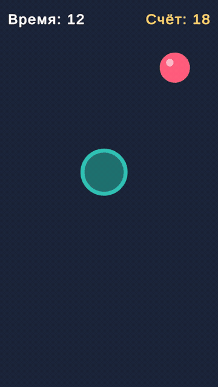

# CatchTheDot_Kudrevatyh

Практика № 2 по дисциплине «Программирование мобильных игр» — мини-игра «Catch the Dot» («Поймай точку»).
Вариант B (индивидуальное задание). Автор: Кудреватых Артем Андреевич.

## Правила

В случайном месте экрана появляется красная точка. Тапните по экрану — корзина (бирюзовое кольцо)
поедет к месту касания. Если корзина накрыла точку, засчитывается очко и точка появляется в новом месте.
За 30 секунд нужно набрать как можно больше очков. После окончания времени показывается экран
«Игра окончена» с итоговым счётом и кнопкой «Играть снова».

## Как устроено

| Скрипт | Объект | Что делает |
|---|---|---|
| `Assets/Scripts/Dot.cs` | Dot | Переносит точку в случайную позицию (`Random.Range`), не выходя за видимую область камеры и не ближе 3 единиц к корзине |
| `Assets/Scripts/Basket.cs` | Basket | Читает тап через Input System (`Pointer.current`), переводит его в мировые координаты (`ScreenToWorldPoint`), едет к цели через `Vector2.MoveTowards` и ловит точку по `Vector2.Distance < catchRadius` |
| `Assets/Scripts/GameManager.cs` | GameManager | Синглтон: счёт, таймер на `Time.deltaTime`, Game Over и перезапуск сцены |

Параметры: скорость корзины 12 ед/с, радиус поимки 0,8 ед, ортографическая камера размером 8
(видимая высота 16 ед), раунд 30 с.

## Окружение

- Unity 6000.6.5f1 (Unity 6.6), шаблон Universal 2D (URP)
- uGUI + TextMeshPro, Input System (Active Input Handling: Input System Package)
- Android: IL2CPP, ARM64, минимальный API 26, Package Name `com.kudrevatyh.catchthedot`

## Сборка

File → Build Profiles → Android → Build (или Build And Run с подключённым телефоном).

## Медиа

- `Media/gameplay_editor.mp4`, `Media/gameplay_editor.gif` — 14 секунд геймплея (запись из редактора)
- `Media/gameover_editor.png` — экран Game Over
